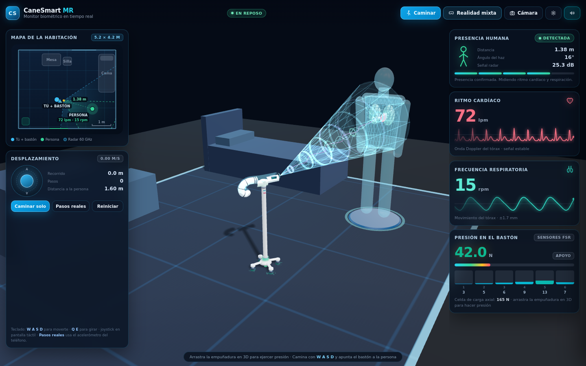
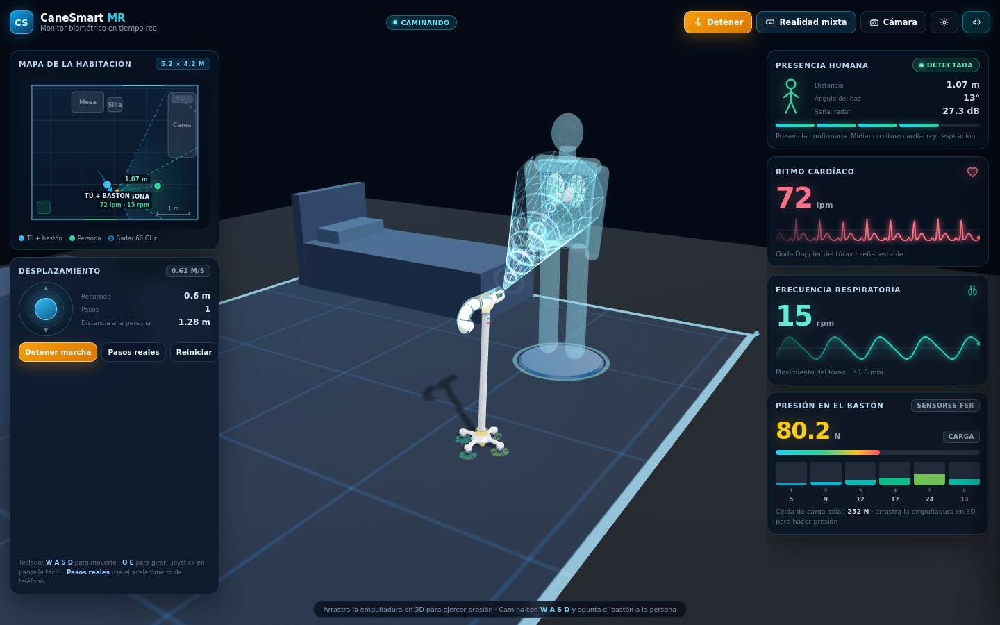
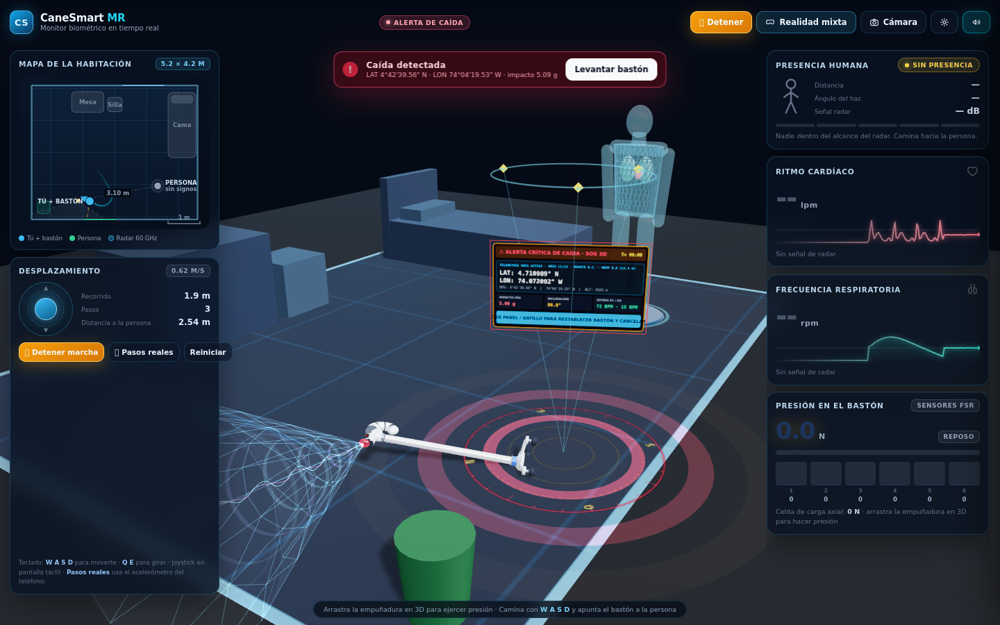

# CaneSmart MR — Monitor biométrico de Realidad Mixta

Simulador interactivo en **3D y Realidad Mixta (WebXR Passthrough)** del bastón inteligente **CaneSmart**, modelado a escala real (`0.88 m`) a partir del plano técnico adjunto. Pensado para verse en el navegador de **Meta Quest** y, mientras tanto, en cualquier PC o móvil.



---

## Qué muestra (sólo los datos importantes)

| Dato | Dónde | Cómo se calcula |
|---|---|---|
| **Presencia humana** | Tarjeta superior derecha + mapa | Cono del radar de 60 GHz (±65°, hasta 3,5 m). Indica confirmación, distancia, ángulo del haz y SNR en dB. |
| **Ritmo cardíaco (FC)** | Tarjeta con onda | Cono estrecho (±30°, 2,95 m) sobre el tórax → onda Doppler con complejo QRS, ondas P/T y muesca dicrótica. En lpm. |
| **Frecuencia respiratoria (FR)** | Tarjeta con onda | Desplazamiento del tórax en la onda de fase FMCW. En rpm. |
| **Presión en el bastón** | Tarjeta inferior + 6 barras | Suma de los 6 sensores **FSR** de la empuñadura (N) y **celda de carga axial** (N), con código de color térmico. |
| **Ubicación en la habitación** | Mapa cenital 5,2 × 4,2 m | Posición y orientación del usuario, punta del bastón, rastro recorrido, conos del radar y persona monitorizada. |
| **Alerta de caída** | Aviso rojo + holograma 3D | Impacto IMU (> 3,5 g) al superar 43° de inclinación; despliega GPS 3D y alarma sonora espacial. |

## Cómo se mueve uno por la habitación

- **`Caminar`** — simulación de marcha guiada: el usuario recorre la ruta con el bastón y el radar va barriendo la sala.
- **Teclado** — `W A S D` desplaza, `Q E` gira.
- **Joystick** en pantalla (táctil o ratón).
- **`Pasos reales`** — usa el acelerómetro del teléfono (`DeviceMotion`): cada paso real mueve tu posición en el mapa.
- **Meta Quest** — tu cabeza es el usuario: la posición real (`local-floor`) se dibuja en el mapa y el bastón te acompaña.



## Interacción directa en 3D

- **Arrastra la empuñadura** hacia abajo para ejercer presión (FSR + celda de carga) y hacia los lados para inclinar el bastón.
- Supera **43°** y suéltalo: el bastón cae físicamente, suena la alarma y aparece el **holograma GPS 3D**.
- **Arrastra la persona** para acercarla o alejarla y comprobar cómo el radar pierde el enganche.
- En Quest: **Grip + Gatillo** con los controles Touch (vibración proporcional a la fuerza).



## Telemetría avanzada (botón ⚙️)

Mapa de calor 6×FSR con centro de presión, tres osciloscopios (celda de carga, agarre, onda de 60 GHz, IMU), perfiles de paciente (reposo, marcha, taquicardia, bradipnea), perfiles de agarre, haz del radar, hologramas, botones 3D, pitido por latido, GPS real y plano original.

## Ejecutar

```bash
npm install
npm run dev     # http://localhost:5173
npm run build   # dist/
```

## Despliegue

La app funciona **como sitio estático** (el `index.html` incluye un `importmap` que resuelve Three.js desde jsDelivr), así que basta publicar la raíz del repositorio o el `dist/` compilado. Ver `DESPLIEGUE-GITHUB-PAGES.md`.

- GitHub Pages: **https://jcasallasv.github.io/canesmart-3d-app/**
- En Meta Quest: abre esa URL en **Meta Quest Browser** y pulsa **Realidad mixta**.

## Estructura

```
index.html                      Interfaz (mapa, tarjetas vitales, cajón avanzado)
src/main.js                     Bucle principal, cámara, interacción 3D, UI
src/world/RoomLocomotion.js     Desplazamiento (teclado, joystick, marcha, pasos, WebXR)
src/ui/RoomMap.js              Mapa cenital con conos de radar y rastro
src/ui/MiniWave.js             Trazas biomédicas en tiempo real
src/ui/TelemetryCharts.js      Mapa de calor FSR y osciloscopios
src/physics/BiomechanicalEngine.js  FSR, celda de carga, CoP, radar 60 GHz, caída IMU
src/models/CaneSmartModel.js   Gemelo digital 1:1 del bastón
src/models/VirtualPatientAndRadar.js  Persona holográfica + haz electromagnético
src/models/FallGpsHologram.js  Baliza GPS 3D de emergencia
src/xr/…                       WebXR, HUD espacial, controles y manos
src/audio/SpatialBioAudio.js   Audio espacial HRTF + alarma y voz en español
src/utils/waveforms.js         Formas de onda cardíaca y respiratoria
```
